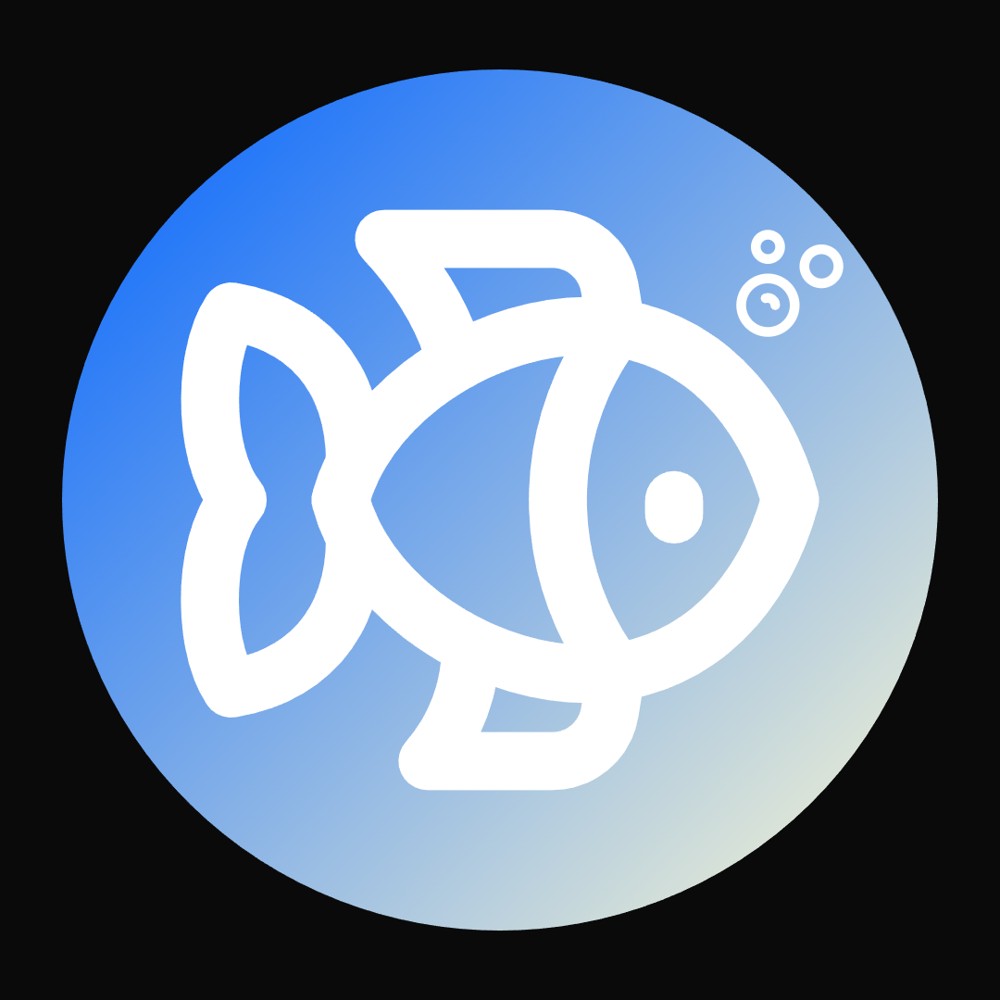

<p align="center">
  
</p>

# Fish

**A small, friendly programming language with a native compiler.**  
Plain words, no hidden conversions, memory freed automatically. Compiles to tiny x86-64 Linux executables with no C and no libc.


> **Heads up:** Fish is a personal project and still young. The native compiler only targets **Linux x86-64**, and several features are not built yet (see [Not built yet](#not-built-yet)). Please tell me if you hit a problem.

---

## A quick look

```
so name = "World"
say "Hello, {name}!"

fun greet(who: text) gives text
  give "Nice to meet you, {who}!"
stop

say greet("Fish")

for i in 1 to 3
  say "step {i}"
stop
```

Run it with the interpreter, or compile it to a real executable:

```
python3 fish.py run examples/hello.fish
python3 fishc.py build examples/hello.fish -o hello && ./hello
```

---

## Why Fish?

I wanted a language that reads like plain English, tells beginners what went wrong in words they can use, and still gives you native speed and safe memory without learning lifetimes.

- **Plain words.** `so`, `say`, `give`, `stop`. Blocks close with `stop`. Try a word from another language (`let`, `return`, `elif`) and Fish tells you what to write instead.
- **No hidden conversions.** Whole numbers and decimals never mix. Use `decimal(x)` and `whole(x)` on purpose.
- **Safe memory, nothing to write.** Every value has one owner and is freed automatically. Borrows last only for one call, so there are no lifetimes.
- **Small output.** Native executables are about 10 KB and statically linked.
- **One front end, two tools.** The interpreter and the compiler share the same lexer and parser, and every test must print the same thing under both.

---

## Getting started

### Requirements

- Python 3.8 or newer
- For the native compiler: **Linux x86-64** with `as` and `ld` (the `binutils` package)

The interpreter (`fish.py`) is plain Python and runs anywhere Python does.

### Run it

```
git clone https://github.com/wishissue/fish.git
cd fish
python3 fish.py run examples/hello.fish
```

### Commands

| Command | What it does |
| --- | --- |
| `python3 fish.py run FILE` | Run with the interpreter |
| `python3 fishc.py run FILE` | Compile to native code and run |
| `python3 fishc.py build FILE -o OUT` | Produce a standalone executable |
| `python3 fishc.py check FILE` | Type check only |
| `python3 fishc.py asm FILE` | Show the generated assembly |
| `python3 tests/run_tests.py` | Run all 107 tests (needs Linux x86-64, `as`, `ld`) |

---

## The language

### Basics

- `so` declares a value, `so var` makes it changeable, `keep` declares a constant
- `say` prints; text interpolation looks like `"{x}"`
- `fun` / `give` / `gives` for functions; recursion works
- `#` line comments and `{ }` block comments
- `if` / `else if` / `else`, also written `or if` / `or`
- `while`, `loop`, `for` (ranges, `down to`, `step`, lists), `break`, `continue`

### Types

whole, decimal, bool, text, `list of T`, nothing. Types are inferred and annotations are optional. Functions are generic by use: each function is compiled once per set of argument types.

### Records, choices and matching

- `record` with fields (`p.x`, and `p.x = 5` needs `so var`)
- `choice` with variants that carry values
- `extend Type` adds methods using `self`
- `match` / `when` with destructuring (`when Circle(r)`, `when Rect(w, 4)`), guards and `or` alternatives
- the native compiler checks that a `match` on a choice covers every variant

### Checked arithmetic

Overflow, divide by zero and list bounds are all checked and stop the program with a clear message. Decimals show up to 6 places with trailing zeros trimmed, so `0.1 + 0.2` shows `0.3`.

---

## Ownership and memory

*Native compiler only. The interpreter accepts the same syntax but does not enforce it.*

| Rule | Example |
| --- | --- |
| Every text, list, record and choice has exactly one owner | |
| `so b = a` **moves** `a` into `b`. Using `a` afterwards is a compile error | `a` was moved on line 3 |
| Passing a value to a function moves it, unless the parameter is borrowed | `fun f(t: ref text)` is called as `f(ref x)` |
| Change something you borrowed with `mut ref` | `fun g(xs: mut ref list of whole)` is called as `g(mut ref xs)` |
| Methods borrow `self` by default | `fun bump(mut self)` can change it |
| `x.copy()` makes an independent deep copy | |

Borrows last only for the call, so they can never outlive their owner. A value can't be lent as `mut ref` while it is also used elsewhere in the same call.

Memory is freed automatically when the owner goes out of scope (including on `break`, `continue` and `give`), and the old value is freed when you assign a new one. A test program that allocates 8 million texts (about 1.5 GB in total) peaks at about 11 MB.

You can't move a value out of a field or list item; borrow it or copy it. Top-level text, lists and records belong to the main program, and functions receive them by `ref`.

See [`examples/ownership.fish`](examples/ownership.fish) for a walkthrough.

---

## Examples

| File | Shows |
| --- | --- |
| [`hello.fish`](examples/hello.fish) | Values, functions, loops, interpolation |
| [`ownership.fish`](examples/ownership.fish) | Moves, `ref`, `mut ref`, `copy` |
| [`decimals.fish`](examples/decimals.fish) | Decimals and explicit conversion |
| [`or_else.fish`](examples/or_else.fish) | `or if` / `or` short forms |
| [`stars.fish`](examples/stars.fish) | Star patterns with `while` and `for` |
| [`matrix.fish`](examples/matrix.fish) | Nested lists, matrix multiplication |
| [`ask.fish`](examples/ask.fish) | Reading input with `ask` (interactive) |

---

## Not built yet

| Missing | Why it isn't done |
| --- | --- |
| `maybe` / `none`, `result` / `try` | Need generics (`of`) in the type checker |
| Generics with `of`, traits, `use` modules, `public` | Language-level work, next |
| Returning borrows (`gives ref T`), storing borrows in records | Needs lifetimes. Borrows are call-scoped on purpose, which keeps them safe without annotations |
| Moving out of a loop (`loop` ... `break`) | The checker is conservative and rejects it; `give` out of a loop works |
| Some temporaries (for example `f()[0]`) are never freed early | Safe but wasteful. Needs temporary tracking in more expression kinds |
| `%` and `**` on decimals, ordering text, text methods, text indexing | Small additions |
| Threads, async, unsafe, extern, inline assembly | Need the rest of the type system first |
| Other platforms | See below |

### Platforms

The native back end is **Linux x86-64 only**. macOS needs different system call numbers and Mach-O output, Windows needs PE output and kernel32 calls, and ARM64 needs a new code generator. None of these can be tested here, so none is claimed.

---

## Under the hood

| Part | Choice |
| --- | --- |
| **Front end** | Lexer and parser in `fish.py`, shared by both tools |
| **Interpreter** | `fish.py` |
| **Compiler** | `fishc.py`: type check, ownership check, x86-64 assembly |
| **Assembling** | System `as` and `ld`; raw Linux system calls only, no libc |
| **Tests** | `tests/run_tests.py` |

### How the tests work

- **Differential tests:** every program must print the same thing under the interpreter and the native compiler.
- **Failure tests:** bad programs must fail with the expected message, at compile time or at run time.
- **Examples:** every file in `examples/` runs under both tools and must match.
- **Memory tests:** programs allocate far more than the heap in total, which proves memory is really reused.

---

## Roadmap

1. ~~Ownership checker and automatic freeing~~ (done)
2. Generics (`of`), `maybe`, `result`, `try`, traits
3. Modules (`use`, `public`) and a small standard library
4. Portable back-end layer, then macOS, Windows and ARM64 targets
5. Rewrite the compiler in Fish itself

---

## Contributing

Report a bug or ask a question: open an issue at [github.com/wishissue/fish/issues](https://github.com/wishissue/fish/issues).  
Contact me directly: [github.com/wishissue](https://github.com/wishissue)

Before sending a change, run `python3 tests/run_tests.py` and make sure everything passes.

## License

[MIT](LICENSE)

---

Made with a lot of `stop`s. 🐟
